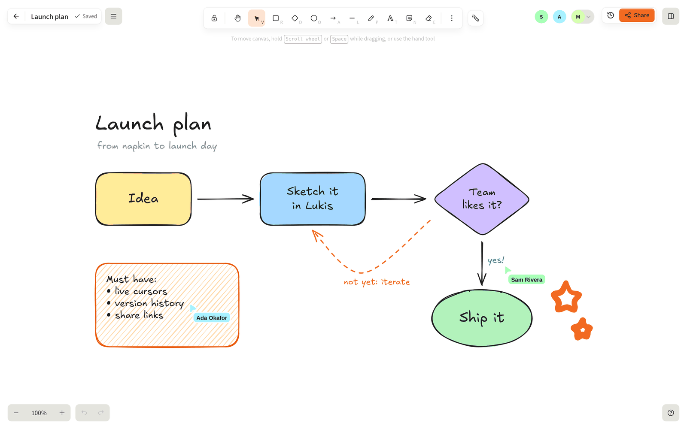
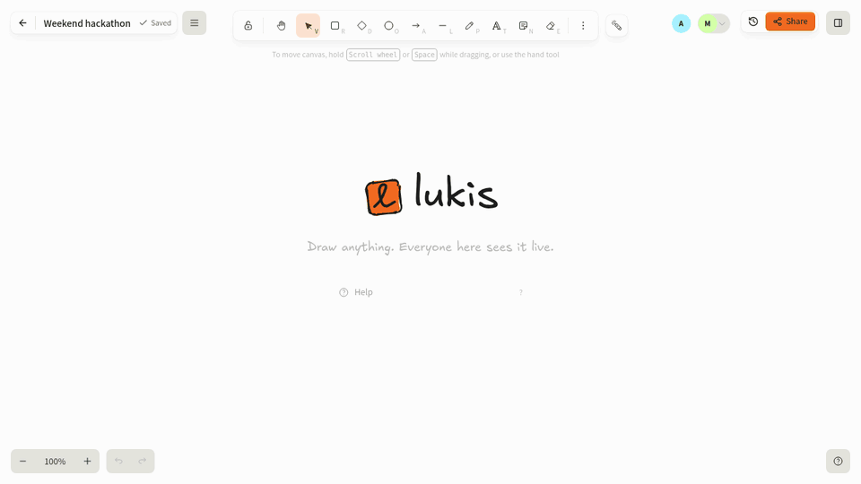
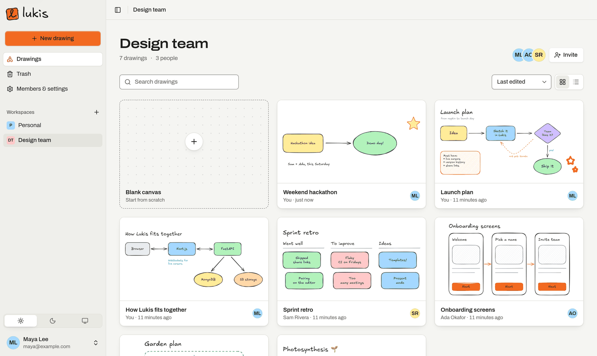
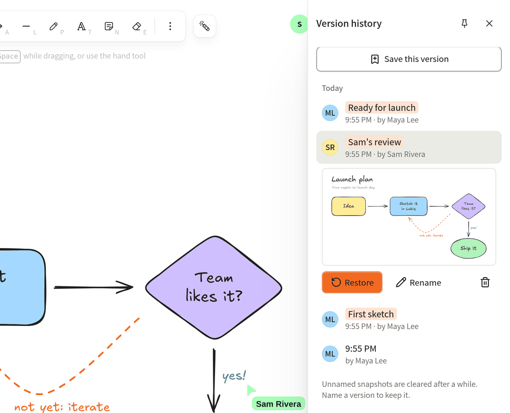
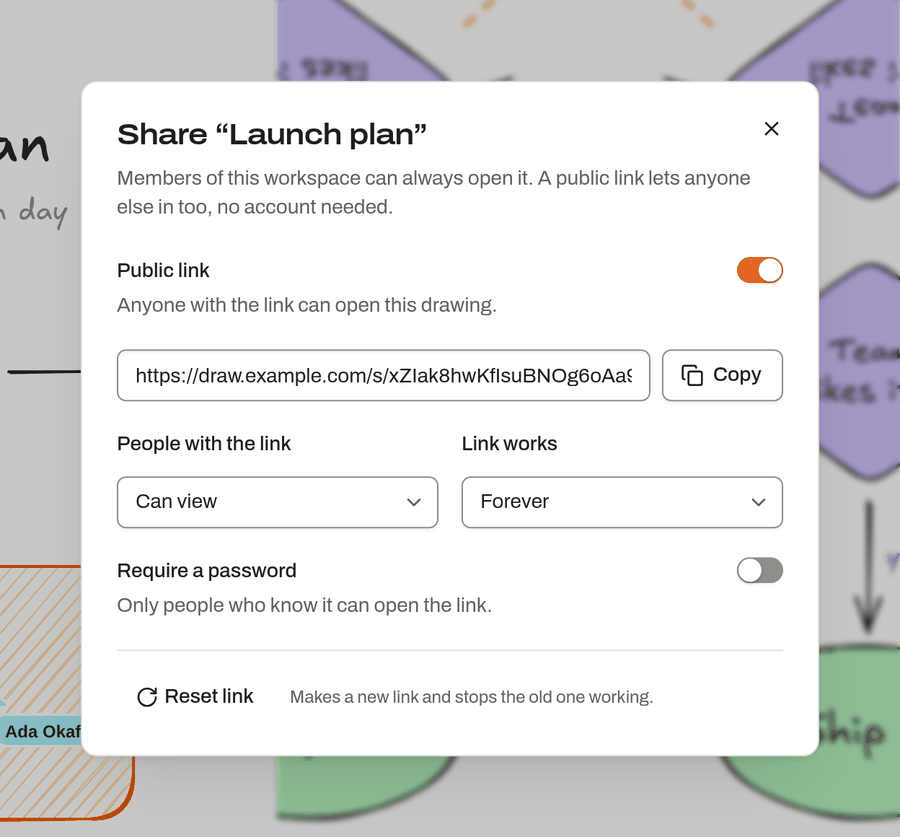
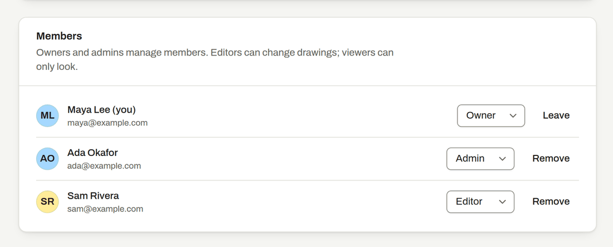
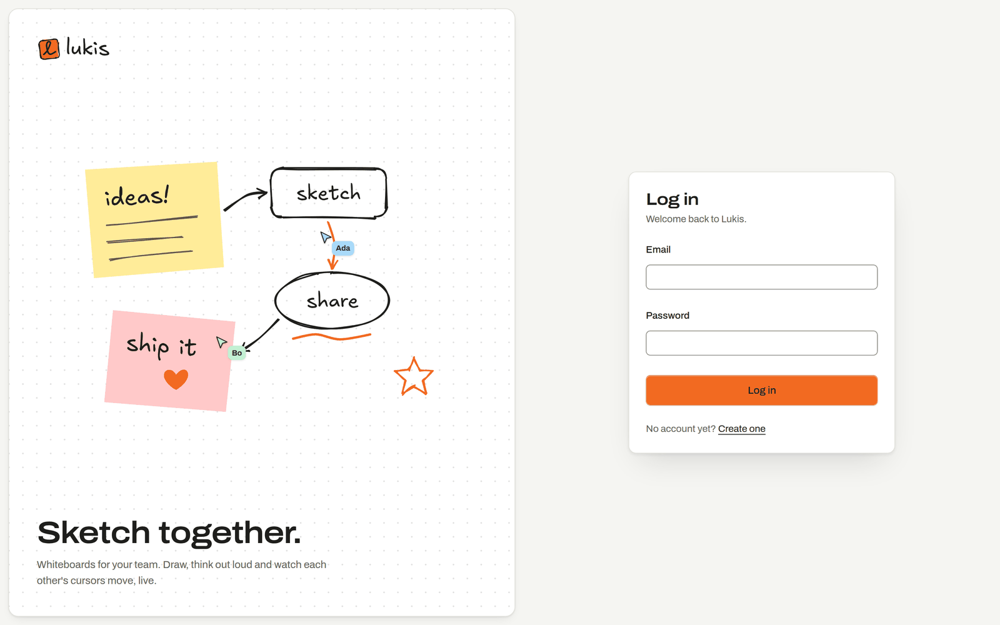
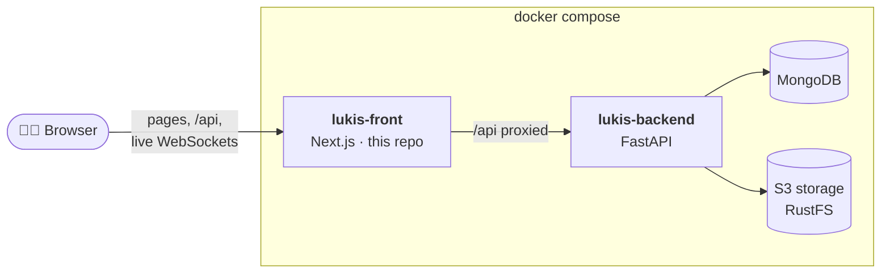

<div align="center">


# Lukis

**A hand-drawn whiteboard for teams, on your own server.**<br>
Sketch ideas, diagrams and plans together in real time. Built on
[Excalidraw](https://github.com/excalidraw/excalidraw).

[](https://github.com/Isma27K/lukis-front/actions/workflows/ci.yml)
[](LICENSE)
[](docs/self-hosting.md)
[](https://github.com/excalidraw/excalidraw)

[**Quick start**](#-quick-start) ·
[Features](#-features) ·
[Self-hosting guide](docs/self-hosting.md) ·
[Development](#-development)

</div>

<br>

<picture>
  <source media="(prefers-color-scheme: dark)" srcset="docs/media/editor-dark.png">
  
</picture>

## Why Lukis

Excalidraw is a wonderful editor, but on its own it's one canvas in one
browser tab. Lukis wraps it in what a team needs to use it every day:

|     |     |
| --- | --- |
| 🗂️ **Workspaces** | Every drawing saved and listed, in a personal space or shared team spaces with owner, admin, editor and viewer roles. |
| 👥 **Live collaboration** | See everyone's cursors and edits as they happen, and follow someone's view while they explain. |
| 🕓 **Version history** | Automatic snapshots while you work, plus named versions you can preview and restore in one click. |
| 🔗 **Share links** | Let anyone view or edit a single drawing without an account, with an optional password and expiry date. |
| 🔐 **Accounts** | Email and password, or Google, GitHub and Microsoft. Invite-only sign-up when you want it. |
| 🐳 **Yours to run** | One `docker compose up`. Your drawings stay on your server: no tracking, no AI reading them. |

## 👥 Draw together, live

Everyone in a drawing sees everyone else's work as it happens. Here Maya
watches while Sam and Ada sketch out their weekend plan:

<p align="center">
  
</p>

## ✨ Features

### A home for every drawing

Each workspace keeps all its drawings, with live thumbnails, who touched each
one last, search, sorting, and a trash you can restore from.

<picture>
  <source media="(prefers-color-scheme: dark)" srcset="docs/media/dashboard-dark.png">
  
</picture>

<br>

<table>
  <tr>
    <td width="50%" valign="top">
      <h3>Go back in time</h3>
      <p>Lukis snapshots drawings while you work. Name the versions worth keeping, preview any of them, and restore with one click (or undo the restore).</p>
      
    </td>
    <td width="50%" valign="top">
      <h3>Share without sign-ups</h3>
      <p>Turn on a public link to let clients, classmates or anyone else view or edit one drawing. Add a password or an expiry date, and reset the link any time.</p>
      
    </td>
  </tr>
  <tr>
    <td width="50%" valign="top">
      <h3>Teams with roles</h3>
      <p>Invite people by link or email. Owners and admins manage members, editors draw, and viewers only look. The backend enforces every rule.</p>
      
    </td>
    <td width="50%" valign="top">
      <h3>Sign in your way</h3>
      <p>Email and password, or Google, GitHub and Microsoft once you add their keys. The site owner decides whether anyone can sign up or only people they invite.</p>
      
    </td>
  </tr>
</table>

**And also:** dark mode everywhere · images in drawings · export to PNG, SVG
and `.excalidraw` · email verification and password reset (with SMTP) · an
admin page to open or close sign-up · daily database backups.

## 🚀 Quick start

All you need is [Docker](https://docs.docker.com/get-docker/). The database
and file storage come bundled.

```sh
git clone https://github.com/Isma27K/lukis-front.git lukis
cd lukis
docker compose up -d
```

Open **<http://localhost:3000>** and create your account. The first account
becomes the site owner, and needs the one-time setup code the server prints
on startup:

```sh
docker compose logs backend | grep "setup code"
```

### Put it online with HTTPS

Point a domain at your server, then create a `.env` file next to
`compose.yaml` with two lines:

```sh
PUBLIC_URL=https://draw.example.com
COMPOSE_PROFILES=caddy
```

Run `docker compose up -d` again. Caddy fetches and renews the certificate by
itself.

The [**self-hosting guide**](docs/self-hosting.md) covers the rest:
- your local network or your own reverse proxy
- email and logging in with Google, GitHub or Microsoft
- backups and updates
- using your own database or S3 storage

## 🧩 How it fits together



Lukis lives in three repositories:

| Repository | What's in it |
| --- | --- |
| **[lukis-front](https://github.com/Isma27K/lukis-front)** (this one) | The Next.js app (dashboard, editor, account and admin pages), plus the Docker Compose stack and the [self-hosting guide](docs/self-hosting.md). |
| [lukis-backend](https://github.com/Isma27K/lukis-backend) | The FastAPI API: accounts, workspaces, scenes, version history, share links, images and the live-collaboration relay. |
| [lukis-editor](https://github.com/Isma27K/lukis-editor) | Our Excalidraw fork (`lukis` branch), built into this app. |

## 🛠️ Development

You'll need Node 24, yarn 1 (for the editor build), Python 3.12+ and a
MongoDB and S3-compatible store for the backend (see its
[README](https://github.com/Isma27K/lukis-backend#readme)).

Clone the three repos side by side, so the app finds the editor at
`../excalidraw`:

```sh
git clone https://github.com/Isma27K/lukis-front.git frontend
git clone https://github.com/Isma27K/lukis-backend.git backend
git clone -b lukis https://github.com/Isma27K/lukis-editor.git excalidraw
```

Start the backend on `http://localhost:8000` (see its README), then:

```sh
cd frontend
npm run excalidraw:build   # builds ../excalidraw into vendor/ and installs deps
npm run dev                # http://localhost:3000
```

`npm run excalidraw:build` packs the editor into `vendor/excalidraw/*.tgz` and
copies its fonts into `public/fonts/`. Both are gitignored, so a fresh
checkout needs it before `npm install` works. Set `BACKEND_URL` if the backend
isn't on `http://localhost:8000`.

| Command | What it does |
| --- | --- |
| `npm run dev` | Development server with hot reload |
| `npm run build` | Production build |
| `npm run lint` | ESLint |
| `npm run typecheck` | TypeScript (after a build, which generates route types) |
| `npm run format` | Prettier |

## 🤝 Contributing

Issues and pull requests are welcome. Before opening a PR, run
`npm run lint`, `npx prettier --check "**/*.{ts,tsx}"`, `npm run build` and
`npm run typecheck`, the same checks CI runs. Editor changes belong in
[lukis-editor](https://github.com/Isma27K/lukis-editor). API changes belong
in [lukis-backend](https://github.com/Isma27K/lukis-backend).

## 📄 License

[MIT](LICENSE). Lukis is built on [Excalidraw](https://github.com/excalidraw/excalidraw)
(MIT). Excalifont in `app/fonts/` is under the SIL Open Font License (see
`app/fonts/excalifont-LICENSE.txt`).
