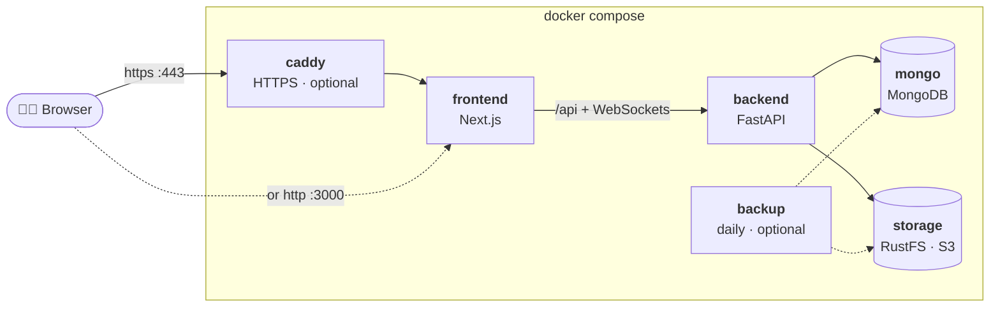

# Self-hosting Lukis

Lukis runs as one Docker Compose stack. You need nothing but Docker: the
database and file storage come bundled, and HTTPS is one setting away.

- [Quick start](#quick-start)
- [Create the first account](#create-the-first-account)
- [Put it on a server](#put-it-on-a-server)
- [Settings](#settings)
- [Email](#email)
- [Log in with Google, GitHub or Microsoft](#log-in-with-google-github-or-microsoft)
- [Site owner and sign-up](#site-owner-and-sign-up)
- [Backups](#backups)
- [Updating](#updating)
- [Using your own database or storage](#using-your-own-database-or-storage)
- [Building from source](#building-from-source)
- [Troubleshooting](#troubleshooting)

## What runs



| Service    | What it does                                                         |
| ---------- | -------------------------------------------------------------------- |
| `frontend` | The web app. Passes `/api` and live-collaboration WebSockets on.     |
| `backend`  | Accounts, workspaces, drawings, version history, live collaboration. |
| `mongo`    | The database (MongoDB 7).                                            |
| `storage`  | S3-compatible file storage ([RustFS](https://rustfs.com)) for images, thumbnails, profile pictures and backups. |
| `caddy`    | *Optional* (`caddy` profile). HTTPS with automatic certificates.     |
| `backup`   | *Optional* (`backup` profile). A database backup every day.          |

Only `frontend` (or `caddy`) is published. The database and storage are only
reachable from the other containers.

**Requirements:** Docker with Compose 2.24 or newer (`docker compose version`).
Docker Desktop on macOS and Windows works too. Lukis itself is light: 1 GB of
RAM is enough for a small team.

## Quick start

```sh
git clone https://github.com/Isma27K/lukis-front.git lukis
cd lukis
docker compose up -d
```

Open **http://localhost:3000**. The first start takes a minute while the
images download; `docker compose ps` shows everything as running (and the
backend as healthy) when it's ready.

> [!TIP]
> You only need two files from this repo: `compose.yaml`, plus
> `docker/Caddyfile` if you want HTTPS. Cloning is just the easiest way to get
> them.

## Create the first account

The first account becomes the **site owner**. So that a stranger who finds a
fresh install can't claim it, registering it needs a one-time setup code,
which the backend prints when it starts:

```sh
docker compose logs backend | grep "setup code"
```

Enter it on the sign-up page. A restart prints a new one until the owner
exists. To pick the code yourself, set `SETUP_CODE` in `.env` before the first
start.

## Put it on a server

All settings go in a `.env` file next to `compose.yaml`:

```sh
cp .env.example .env
```

Then pick one of these and run `docker compose up -d` again.

### With a domain and HTTPS (recommended)

Point your domain's DNS at the server, open ports 80 and 443, and set:

```sh
PUBLIC_URL=https://draw.example.com
COMPOSE_PROFILES=caddy
```

Caddy fetches a Let's Encrypt certificate on its first start and renews it
by itself. Session cookies are HTTPS-only automatically when `PUBLIC_URL`
starts with `https://`.

### On your local network

Without a domain, open the app's port to the network and use the machine's
address:

```sh
PUBLIC_URL=http://192.168.1.20:3000
LUKIS_PORT=3000
```

### Behind a reverse proxy you already run

Keep the default `LUKIS_PORT` (`127.0.0.1:3000`, this machine only), set
`PUBLIC_URL` to the public address, and point your proxy at port 3000.
[`docker/nginx.conf.example`](../docker/nginx.conf.example) shows what nginx
needs: WebSocket upgrades, 16 MB request bodies, and `X-Forwarded-For` set to
the visitor's address (the backend's rate limits rely on it).

### Behind a Cloudflare Tunnel

Cloudflare does HTTPS, and Caddy passes on the visitor's real address from
the tunnel. Set:

```sh
PUBLIC_URL=https://draw.example.com
COMPOSE_PROFILES=caddy
CADDY_ADDRESS=:80
```

Point the tunnel's service at `http://localhost:80` and turn on Cloudflare's
"Always Use HTTPS". `CADDY_ADDRESS=:80` keeps Caddy on plain HTTP, so it
doesn't try to get its own certificate or redirect the tunnel's requests.

## Settings

Every setting is optional. [`.env.example`](../.env.example) has them all,
with explanations. The ones you're most likely to need:

| Setting | Default | What it's for |
| --- | --- | --- |
| `PUBLIC_URL` | `http://localhost:3000` | The address people use. Links in emails, link previews and login redirects use it. |
| `LUKIS_PORT` | `127.0.0.1:3000` | Where the app is published. `3000` opens it to the network. |
| `COMPOSE_PROFILES` | *(none)* | `caddy` for HTTPS, `backup` for daily backups, or `caddy,backup`. |
| `SETUP_CODE` | *(random, in the logs)* | The code the first account needs. |
| `SMTP_HOST` … `MAIL_FROM` | *(off)* | Outgoing email. See [Email](#email). |
| `GOOGLE_CLIENT_ID` … | *(off)* | Logging in with Google, GitHub or Microsoft. |
| `S3_ACCESS_KEY`, `S3_SECRET_KEY` | `lukis`, `lukis-storage-secret` | Keys for the bundled storage. Change them before the first start if you like; it isn't reachable from outside either way. |
| `FRONTEND_TAG`, `BACKEND_TAG` | `latest` | Which image versions to run. |

## Email

Email is optional. Fill in the `SMTP_*` settings and Lukis:

- asks new users to confirm their address, and requires it before they join a
  workspace
- offers password reset
- emails invite links

Without `SMTP_HOST`, none of that appears: admins copy invite links from the
settings page and send them however they like.

## Log in with Google, GitHub or Microsoft

Optional, like email. Each provider appears on the login page once its client
ID and secret are in `.env`. Register this redirect URI with each one, using
your `PUBLIC_URL` and the provider's name (`google`, `github` or `microsoft`):

```
https://draw.example.com/api/auth/oauth/google/callback
```

- **Google:** Google Cloud console → APIs & Services → Credentials → Create
  credentials → OAuth client ID → Web application. Add the URI under
  "Authorized redirect URIs". The consent screen needs only the `openid`,
  `email` and `profile` scopes. Set `GOOGLE_CLIENT_ID` and
  `GOOGLE_CLIENT_SECRET`.
- **GitHub:** Settings → Developer settings → OAuth Apps → New OAuth App. The
  URI goes in "Authorization callback URL". Set `GITHUB_CLIENT_ID` and a
  generated `GITHUB_CLIENT_SECRET`.
- **Microsoft:** Microsoft Entra admin center → App registrations → New
  registration, with a "Web" redirect URI. Make a client secret under
  Certificates & secrets (it expires; note when). Set `MICROSOFT_CLIENT_ID`
  (the Application ID) and `MICROSOFT_CLIENT_SECRET`. `MICROSOFT_TENANT`
  decides who may log in: `common` for any Microsoft account, `organizations`
  for work and school ones, or your tenant ID for only your organization.

How accounts work with them:

- The first login with a provider creates an account with its name and email
  address, if sign-up allows it. The site owner's account is always made with
  a password, since it needs the setup code.
- Logins are matched on the provider's ID for the person, never on the email
  address. Someone who already has a password account with that address is
  asked to log in with the password, then connect the provider under Your
  account → Connected accounts.
- Accounts made this way have no password until they set one on their
  account page. A provider can't be disconnected while it's the only way left
  to log in.

## Site owner and sign-up

The site owner gets **Site settings** in the user menu. Anyone can sign up
until the owner switches that off there. After that, only people the owner
invites can create an account: with a sign-up invite from Site settings, or a
workspace invite the owner sends. Everyone who already has an account can
still log in.

If the owner is ever locked out, fix it from the server:

```sh
docker compose exec backend python -m scripts.site show
docker compose exec backend python -m scripts.site set-owner you@example.com
docker compose exec backend python -m scripts.site registration open   # or closed
```

## Backups

Add `backup` to `COMPOSE_PROFILES`. Every 24 hours the `backup` service writes
`backups/<db>-<time>.tar.gz` to the storage bucket (or `BACKUP_BUCKET`) and
deletes ones older than `BACKUP_KEEP_DAYS` (default 14, never the newest).

```sh
docker compose run --rm backup python -m scripts.backup run    # one now
docker compose run --rm backup python -m scripts.backup list
# Restore. --drop replaces collections that already have data.
docker compose run --rm backup python -m scripts.backup restore \
  backups/lukis-20261027T030000Z.tar.gz --drop
docker compose restart backend   # recreates indexes
```

These cover the database. Images and thumbnails live in the storage volume
(`lukis_storage_data`) or your own bucket, so back that up too. With the
bundled storage, the backups sit on the same machine; copy them off it, or
[use your own storage](#using-your-own-database-or-storage) somewhere else.

## Updating

```sh
docker compose pull
docker compose up -d
```

To pin a version or roll back, set `FRONTEND_TAG` and `BACKEND_TAG` in `.env`
to `sha-<short commit>` tags (listed under each repo's Packages on GitHub),
then run the same two commands.

## Using your own database or storage

The bundled MongoDB and storage can each be swapped for one you already run.
In `.env`, list the matching file in `COMPOSE_FILE` and fill in its settings:

```sh
# MongoDB 7.0 or newer. Its user needs readWrite on MONGO_DB.
COMPOSE_FILE=compose.yaml:docker/compose.own-mongo.yaml
MONGO_URL=mongodb://lukis:<password>@db.example.com:27017/?authSource=admin

# Any S3-compatible storage: AWS S3, Cloudflare R2, MinIO, RustFS…
COMPOSE_FILE=compose.yaml:docker/compose.own-storage.yaml
S3_ENDPOINT=https://s3.eu-central-1.amazonaws.com
S3_BUCKET=lukis
S3_REGION=eu-central-1
S3_ACCESS_KEY=...
S3_SECRET_KEY=...
```

Use both by listing both files, separated by colons. A database or storage on
the same machine is reachable as `host.docker.internal`. The bucket is created
on first start if it doesn't exist and the keys are allowed to.

## Building from source

The images are built by CI on every push to `main`. To build your own,
check out the three repos side by side:

```sh
git clone https://github.com/Isma27K/lukis-front.git frontend
git clone https://github.com/Isma27K/lukis-backend.git backend
git clone -b lukis https://github.com/Isma27K/lukis-editor.git excalidraw
```

Then build the editor (needs Node 24 and yarn 1) and the stack:

```sh
cd frontend
git -C ../excalidraw checkout "$(cat .excalidraw-ref)"
npm run excalidraw:build
docker compose -f compose.yaml -f docker/compose.build.yaml up -d --build
```

`LUKIS_BACKEND_SOURCE` points the build at a backend checkout somewhere else.

## Troubleshooting

**Where are the logs?** Everything logs to Docker. The backend and frontend
write one JSON object per line:

```sh
docker compose logs -f backend
docker compose logs backend | grep '"level": "error"'
```

**Port 3000 (or 80/443) is already in use.** Set `LUKIS_PORT` to another
port, for example `127.0.0.1:3100`, and `PUBLIC_URL` to match
(`http://localhost:3100`).

**Logging in seems to work, then you're logged out.** `PUBLIC_URL` doesn't
match the address in the browser. With an `https://` `PUBLIC_URL` cookies are
HTTPS-only, so opening the app over plain HTTP loses them. Set `PUBLIC_URL` to
the exact address you use.

**Live collaboration doesn't connect.** Same cause: WebSockets are only
accepted from `PUBLIC_URL`. Behind your own proxy, make sure it passes
WebSocket upgrades (see `docker/nginx.conf.example`).

**The backend never becomes healthy.** `docker compose logs backend` says
why. Usually the database or storage isn't reachable, or (with your own
storage) the keys can't create or read the bucket.

**Starting over.** `docker compose down -v` deletes the containers *and all
data* (the database and storage volumes).
